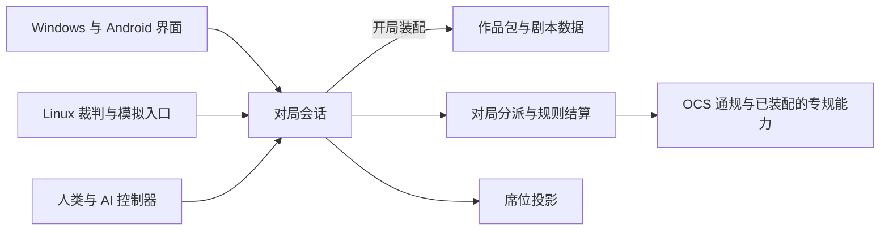

# OCS Godot 纯 GDScript 架构方案

2026-11-27 · 适用于《第三冬》及后续 OCS 作品。

**一个 Godot 工程、一套可无头运行的规则内核、多个独立作品包。** 使用 Godot 4.7 标准版与 GDScript。Windows 和后续 Android 客户端、联机裁判及 Linux 无头模拟调用同一套对局代码。TypeScript 在迁移期负责行为对照，也可在开发期生成归一化数据。发行包以 Godot 和随包资源独立运行。

当前原生实现已验证随机数、命令回执、有限库存抽取及 08「瓶中蝎」从初设到双方确认的全部部署命令，实库对照推进到修订 31 和首回合飞机整备入口。现有菜单进入 08 后仍由 Node 桥接结算。本文定义目标结构与迁移步骤，规则优先级、席位权限及发布约束见[项目约束](Godot项目约束.md)。 [现有实现及复现步骤](../games/third-winter/godot/README.md#原生迁移回归)

## 1. 工程结构与依赖方向

08 迁移先在 `games/third-winter/godot/` 中沿用下列 `res://` 布局。接入第二个实际作品前，将 `project.godot` 和同一份 `res://` 目录整体移到仓库根 `godot/`，单独验证相对路径、启动和导出。

```text
res://
  project.godot
  scripts/
    core/                 # 命令信封、回执、确定性随机、公共类型
    rules/series/         # OCS 通规，按移动、补给、战斗等机制组织
    match/                # 对局状态、命令分派、阶段和待决应答
    view/                 # 按观察席位生成可见盘面、事件和操作
    data/                 # 读取、校验和归一化版本化数据
    session/              # 作品注册和开局装配、提交、存档与恢复
    controllers/          # 本地人类、网络客户端、外部 AI 和 LLM 适配
    ui/                   # 菜单、地图视口、算子堆叠、动作与应答面板
    headless/             # Linux 联机裁判、外部模拟入口
  works/<work_id>/
    work.json             # 作品标识、适用规则版本、剧本列表
    rules/                # 本作品的规则覆盖与能力实现
    scenarios/<scenario_id>/
      scenario.json       # 剧本声明、数据引用、所需能力
      data/               # 归一化地图、初设、增援等运行数据
    assets/               # 地图贴图、算子图、辅助卡和界面资源
  tests/                  # 无头测试、合成夹具与迁移对照向量
```

| 职责 | Godot 实现与依赖方向 |
| --- | --- |
| 规则与结算 | 通规、作品专规、剧本规则、`match` 和 `view` 使用 `RefCounted`、静态方法或普通数据。作品依赖通规，剧本依赖所属作品，`match` 接收装配好的规则能力，`view` 通过只读查询生成投影。 |
| 开局与运行 | `session` 统一将已校验数据、规则能力、初始种子和席位装配成每局独立的会话。文件读写、网络和控制器调用留在边界层。 |
| 表现与入口 | Windows 和 Android 使用 `.tscn`、`Control`、`Node2D` 和信号组织界面。场景由父级注入会话或远端连接，加载后接收投影并提交操作。Linux 入口直接装配会话。 |

`Autoload` 中的 `AppState` 保存当前作品、剧本、模式和界面选择。对局状态、随机数和待决应答由各自的会话持有。地图和动作面板通过参数和信号连接，可以按作品更换素材或组合辅助卡组件。 [Godot 场景组织](https://docs.godotengine.org/en/4.7/tutorials/best_practices/scene_organization.html) · [Godot Autoload 指南](https://docs.godotengine.org/en/4.7/tutorials/best_practices/autoloads_versus_regular_nodes.html)



## 2. 规则三层与机制装配

| 规则来源 | 负责内容 | 地面移动示例 |
| --- | --- | --- |
| OCS v4.3 通规 | 系列共用的判定、计算与流程。 | 相邻格、行动力、ZOC、最低移动和停止。 |
| 作品专规 | 本作适用的表、例外、可选能力和规则窗口。 | 第三冬的地形表、天气修正、渡口和过河条件。 |
| 剧本规则 | 本局地图范围、初设、日期、增援、胜负条件和具体例外。 | 09 的可用格以及第 29 坦克军冻结与释放条件。 |

- 覆盖按具体判定与适用窗口注册。剧本规则优先，其次作品专规，再沿用通规默认。改动某项资格判定时，该机制的其他约束继续适用。静态例外使用数据和表，需要读取局面的例外使用机制所需的最小类型化接口。
- 一个机制有一个状态写入入口。以移动为例，开局装配邻接、通行费、跨越资格与 ZOC 等查询。预演、合法目的格查询及正式执行调用同一份资格判定，结算后通过会话发布新盘面。地图视图与控制器都读该盘面的投影。
- 回合按阶段、环节和步组织。跨方应答记录发起机制、当前责任方、待答步骤及结算后的返回位置。作品或剧本只在已声明的规则窗口配置自己的义务或例外。规则注释和开发诊断用 `OCS v4.3`、`TTW SR` 或 `TTW S08` 等来源前缀定位具体条款。 [条款注释格式](Godot项目约束.md#条款注释格式)

现有 TypeScript `evaluateGroundStep` 的盘面查询接口可作为首个移动模块的迁移参考。用 08 验证选择、预演、确认移动与拒绝，再用 09 的不同地图和释放条件验证复用。 [通规移动实现](../packages/series/src/ground-movement.ts) · [09 剧本规则](../games/third-winter/src/ttw/campaign/kirovograd.ts)

## 3. 作品包与开局

| 文件或入口 | 约定 |
| --- | --- |
| `work.json` | 提供稳定的 `workId`、作品数据版本、适用通规版本及所含剧本。菜单从作品注册表读取这些元数据。 |
| `scenario.json` | 提供稳定的 `scenarioId`、数据版本及指纹、地图和初设数据引用、所需规则能力。面向人类的名称和说明只用于显示。 |
| 作品注册 | 由装配入口显式登记每个作品包和它提供的 GDScript 规则能力。共享层新增通规或中立能力时，记录规则依据。 |
| 开局 | 按 `workId` 和 `scenarioId` 解析作品包，校验规则与数据版本、格号和单位引用及所需能力，然后装配规则并创建初设记录。普通剧本装配一个作品包。 |

归一化 JSON 保存规则格网、印刷表、单位定义和初设。贴图、场景与主题可用 Godot `Resource` 管理，由客户端按需加载。按路径加载的 `Resource` 可以被复用，算子位置、损失、库存、阶段和骰序则由每局独立的记录持有。格号和实体 ID 供规则、网络和存档使用，像素坐标只用于客户端绘制与命中。 [Godot Resource](https://docs.godotengine.org/en/4.7/classes/class_resource.html)

第二个作品的接入测试从注册、选剧本、开局、执行一步命令到续档走完整入口。已有共用机制的接入改动集中于新作品包和注册处。作品新增规则能力按其所属层接入并用小盘面回归。

**联合剧本单独排期。** 项目方已处理地图和剧本数据。《第三冬》和后续各单作品全部实现并验收后，才接入联合剧本。联合剧本用独立装配描述引用多个作品包，解析跨地图接缝、同号格、算子归属和专规适用范围，共用既有结算入口。单作品阶段保留多作品装配边界。

## 4. 会话、命令与存档

| 会话能力 | 输入与输出 |
| --- | --- |
| `submit(seat, command)` | 提交 `{id, expectedRevision, action}`。会话从本地控制者或认证连接确定席位，`action.type` 决定机制。返回成功回执或稳定的拒绝码。 |
| `project(viewer)` | 按观察席位返回可见盘面、修订、阶段、当前待答方与事件。盘面状态留在会话内。 |
| `legal_actions` / `preview` | 在指定修订查询动作、目标及参数约束，路径等组合操作可以分步查询。预演在隔离的状态上运行，保留权威盘面、修订和骰序。 |
| 续档与重连 | 本机从已提交存档恢复，远程客户端按权威修订重新同步；双方恢复待决应答和合法动作。 |

命令按局串行。同一席位、同一 ID 的成功重试返回原回执；新提交校验修订与行动权限。在需要续局的正式对局中，新状态、修订、回执与骰序一并持久化，然后确认成功。存档包含作品、剧本、规则版本、数据指纹和对局记录。随机数沿用确定性 `mulberry32`，以种子、内部状态与抽取次数支持回放。Windows、Android 和 Linux 用同一初始条件和命令序列比对盘面、应答和骰序。旧 08 档继续按迁移阶段核对版本和原数据指纹，是否可直接读取以旧档实测为准。 [回执语义](../packages/match-core/src/command-log.ts) · [旧 08 存档实现](../games/third-winter/desktop/local/store.mjs)

## 5. 游戏模式、外部 AI 与 LLM

五种模式使用同一会话，模式只决定谁控制哪些席位、怎样连接，以及该席位能做哪些操作。

| 模式 | 会话与控制分配 |
| --- | --- |
| 单人 SOLO | 本机玩家轮流控制两边，按待答方切换。 |
| 双人 PVP | 权威裁判运行会话，两位玩家各控一方。 |
| 多人 PVP | 权威裁判运行多席位会话，至少一方由多位玩家协作。房间定义编制、单位或共享决策的权限及应答责任。 |
| 单人 PVE | 本地玩家和外部 AI 各占一方。 |
| 多人 PVE | 多位人类玩家通过房间控制同阵营席位，外部 AI 控制对方。 |

Linux 无头模拟直接装配 GDScript 会话，供第三方通过 `describe`、受控 `reset`、`observe`、`legal_actions` 和 `step` 运行模拟。项目交付协议、启动入口和联调样例。训练框架、奖励策略、模型权重及托管由第三方负责。

LLM 通过可选适配器提供指挥建议。它读取当前席位的可见观测，返回关联请求与修订的目标和优先级。AI 控制器查询合法动作并生成命令，权威会话重新校验后结算。超时、过期、非法建议和断连保留当前应答。接口用确定性替身测试，回放记录实际接受的命令。 [模式与席位约束](Godot项目约束.md#4-游戏模式与席位) · [外部 AI 约束](Godot项目约束.md#5-外部-ai-与-linux-无头训练) · [LLM 指挥约束](Godot项目约束.md#6-llm-指挥-api)

## 6. 客户端、无头入口与导出

- **Windows**。沿用现有菜单和地图场景作为第一个界面入口。将键鼠事件转成游戏操作，通过兼容 `model + view` 的会话适配器替换地图对 `EngineBridge` 的调用。按实际迁移范围调整投影。
- **Android**。沿用相同的规则、数据、存档与联机协议。UI 层处理触摸选子、动作入口、缩放、视口适配及明确确认。本机和联机分别从最后已提交的存档或权威修订恢复。用真机验证进入地图、触屏落子、后台续档和跨平台入房。 [Godot Android 导出](https://docs.godotengine.org/en/4.7/tutorials/export/exporting_for_android.html)
- **Linux**。裁判与训练模拟使用明确的无头入口。裁判持有正式对局与席位权限，模拟入口另行提供种子和重置能力。无头发行只保留规则、数据和所需脚本，客户端贴图与场景由界面加载。 [Godot 专用服务器导出](https://docs.godotengine.org/en/4.7/tutorials/export/exporting_for_dedicated_servers.html)
- **资源与分发**。用同一工程配置不同发行目标，导出时显式纳入动态引用的运行 JSON 和所选作品资源。发布包读取 `res://` 数据，运行存档写入 `user://`。在独立环境验证资源路径、大小写、加载、落子和续档。 [Godot 导出说明](https://docs.godotengine.org/en/4.7/tutorials/export/exporting_projects.html)

## 7. 实施顺序与验收

| 阶段 | 交付 | 通过条件 |
| --- | --- | --- |
| 基础和基准 | GDScript 随机数、命令回执、有限池、无头运行器、08 参考记录。 | 与 TypeScript 向量一致。08 修订 0 的真实初设、Alert 抽取和骰序一致。此项已有实现。 |
| 08 第一条原生链路 | 继续实现部署、原生投影、地面移动、存档与会话接线。 | 从菜单进图，完成部署和一次移动，可续档。逐步对照回执、修订、待答方、盘面和骰序。错方、过期及非法目标拒绝保持原记录。 |
| 08 现有功能迁齐 | 按机制迁移已接的补给、战斗、空军及跨方应答。 | 现有 08 对照序列逐步一致，已有用例迁移或提供等价覆盖，随后切到原生默认入口。 |
| 战役和独立作品 | 09 验证移动、地图裁切和释放条件等复用，01 验证全景初设并补齐生产会话装配。接入第二个作品前移动工程根，按作品包接入。 | 09 子集和 01 全景分别验收。第二作品通过正常菜单、命令与续档入口运行，共用机制无需新增该作品的专用分支。 |
| 发行和控制器 | Windows 独立导出、双人和多人 PVP、单人和多人 PVE、Linux 无头与 LLM 指挥接口。Android 按后续适配目标验收。 | Windows 无 Node 环境运行。多人席位正确拒绝越权、处理并发和重连。Linux 与客户端按同一命令回放，外部控制器和 LLM 替身可完成合法操作。 |
| 联合剧本 | 《第三冬》和后续各单作品全部验收后，接入已处理的数据。 | 验证跨图移动与补给、规则适用范围和联合胜负，复跑单作品回归。 |

每个新增机制至少验证正常命令路径、拒绝路径和实际受影响的邻接规则。移植阶段用 TypeScript 比对状态和投影，归一化临时菜单键并保留有规则意义的序列顺序。全剧本对局验收由项目方统一安排。 [迁移计划与模块映射](../games/third-winter/docs/2026-11-27-核心算法全GDScript迁移方案与Unity对比.md) · [第三冬任务清单](../games/third-winter/TASKS.md)
